<!-- Code generated by tooling/generate.py; DO NOT EDIT. -->

<a href="../../../README.md">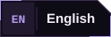</a> <a href="../../../locales/readme/ru/README.md">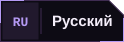</a> 

 

<a href="#work"><picture><source media="(max-width: 600px)" srcset="../../../assets/generated/readme/ru/dashboard/summary-compact.svg">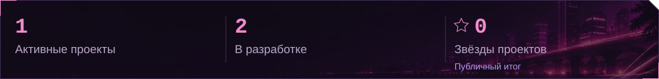</picture></a>

<a href="#work"><picture><source media="(max-width: 600px)" srcset="../../../assets/generated/readme/ru/sections/work-compact.svg"></picture></a>

<a href="https://github.com/pattsys/pattsys"><picture><source media="(max-width: 600px)" srcset="../../../assets/generated/readme/ru/projects/01-compact.svg">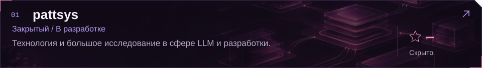</picture></a>

<a href="https://github.com/pattsys/pattsys-registry"><picture><source media="(max-width: 600px)" srcset="../../../assets/generated/readme/ru/projects/02-compact.svg">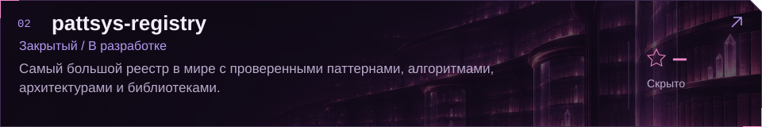</picture></a>

<a href="https://github.com/Mioji/Mioji"><picture><source media="(max-width: 600px)" srcset="../../../assets/generated/readme/ru/projects/03-compact.svg">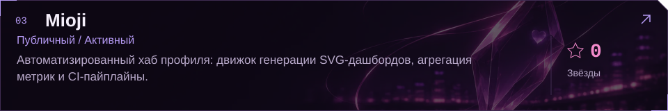</picture></a>

<a href="#activity"><picture><source media="(max-width: 600px)" srcset="../../../assets/generated/readme/ru/sections/activity-compact.svg"></picture></a>

<a href="https://github.com/Mioji?tab=overview"><picture><source media="(max-width: 600px)" srcset="../../../assets/generated/readme/ru/dashboard/activity-compact.svg">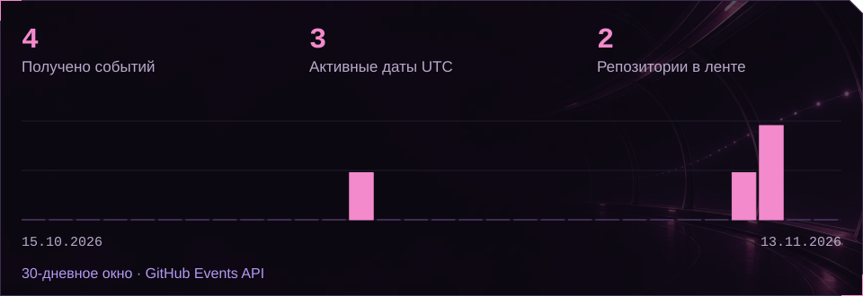</picture></a>

<a href="#profile"><picture><source media="(max-width: 600px)" srcset="../../../assets/generated/readme/ru/sections/profile-compact.svg"></picture></a>

<a href="https://github.com/Mioji"><picture><source media="(max-width: 600px)" srcset="../../../assets/generated/readme/ru/dashboard/profile-compact.svg">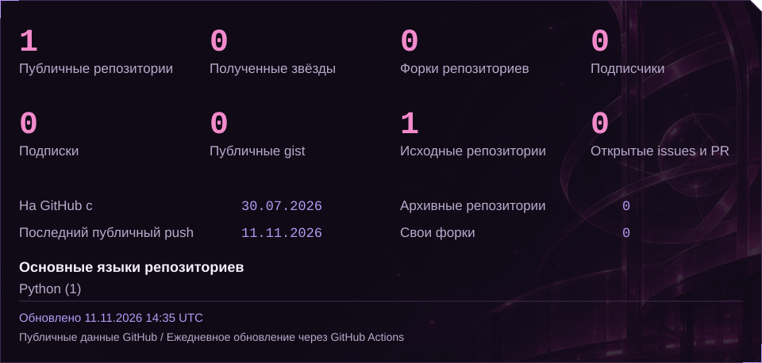</picture></a>

<a href="#skills"><picture><source media="(max-width: 600px)" srcset="../../../assets/generated/readme/ru/sections/skills-compact.svg"></picture></a>

<a href="#skills"><picture><source media="(max-width: 600px)" srcset="../../../assets/generated/readme/ru/skills/languages_label-compact.svg">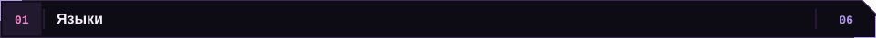</picture></a>

&nbsp; &nbsp; &nbsp; &nbsp; &nbsp; 

<a href="#skills"><picture><source media="(max-width: 600px)" srcset="../../../assets/generated/readme/ru/skills/devops_label-compact.svg">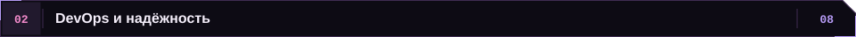</picture></a>

&nbsp; &nbsp; &nbsp; &nbsp; &nbsp; &nbsp; &nbsp; 

<a href="#skills"><picture><source media="(max-width: 600px)" srcset="../../../assets/generated/readme/ru/skills/ai_label-compact.svg">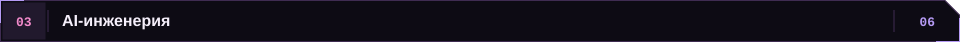</picture></a>

&nbsp; &nbsp; &nbsp; &nbsp; &nbsp; 

<a href="#knowledge"><picture><source media="(max-width: 600px)" srcset="../../../assets/generated/readme/ru/sections/knowledge-compact.svg">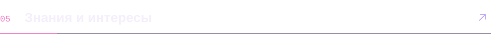</picture></a>

<a href="https://t.me/mioji1"><picture><source media="(max-width: 600px)" srcset="../../../assets/generated/readme/ru/dashboard/knowledge-compact.svg">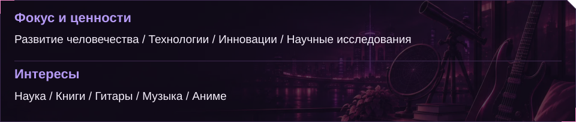</picture></a>

Код: <a href="../../../LICENSES/MIT.txt">MIT</a> · Арт и профиль: <a href="https://creativecommons.org/licenses/by-nc-nd/4.0/">CC BY-NC-ND 4.0</a> · <a href="../../../LICENSE">LICENSE</a>

